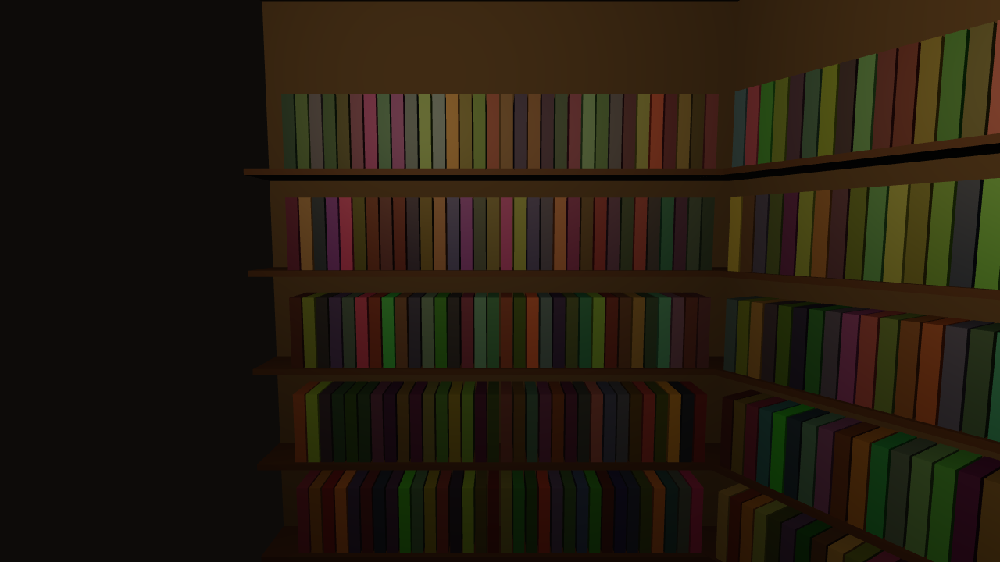

# Scriptorium.3d

**Live: https://valmlord.github.io/scriptorium-3d/**

A Cyrillic Library of Babel you can walk through.

Every text of 3200 characters that can be written in the 36-symbol Russian alphabet already exists here,
each on its own page, on its own shelf, in its own hexagonal room. Nothing is stored: the library is a
**bijection** between an address and a page, so a book can be located by its address, or an address can
be located by its text.

Rendered in Three.js, choreographed with GSAP.

## How it works

The address of a page (room, wall, shelf, volume, page number) is linearised into a single integer, and
that integer is put through a 10-round balanced Feistel network over `Z_(36^3200)`. The result, read in
base 36, is the page. Because the network is a permutation of exactly that domain, running it backwards
turns any text into the one address where it lives. That is the entire search feature: not an index, an
inverse.

## Documentation

| Document                                | What it holds                                                                                |
| --------------------------------------- | -------------------------------------------------------------------------------------------- |
| [spec.md](docs/spec.md)                 | Source of truth: the alphabet, the address model, the cipher, the URL scheme, the public API |
| [decisions.md](docs/decisions.md)       | Architecture decision records, including the alternatives that lost                          |
| [roadmap.md](docs/roadmap.md)           | Milestones, each with its tests and the question it has to answer before it closes           |
| [architecture.md](docs/architecture.md) | Layer invariants, the render loop, determinism; the layer rules are enforced by lint         |
| [testing.md](docs/testing.md)           | What is tested where, and why property tests and mutation testing carry this project         |
| [code-style.md](docs/code-style.md)     | Typing, naming, errors, comments                                                             |
| [CONTRIBUTING.md](CONTRIBUTING.md)      | Branches, atomic commits, pull requests                                                      |

Worth reading first if you only read one: ADR-0002 on why the bijection is a Feistel network rather than
the modular multiplication the original library uses, and ADR-0003 on why the format is frozen.

## Status

Work in progress, built one milestone at a time in the order set out in [roadmap.md](docs/roadmap.md),
each with its tests and the question it has to answer before it closes. The live site is deployed from
`main` on every push, so it is always the current state, and the
[merged pull requests](https://github.com/valmlord/scriptorium-3d/pulls?q=is%3Apr+is%3Amerged) are the
record of what has landed.

## License

[MIT](LICENSE)
